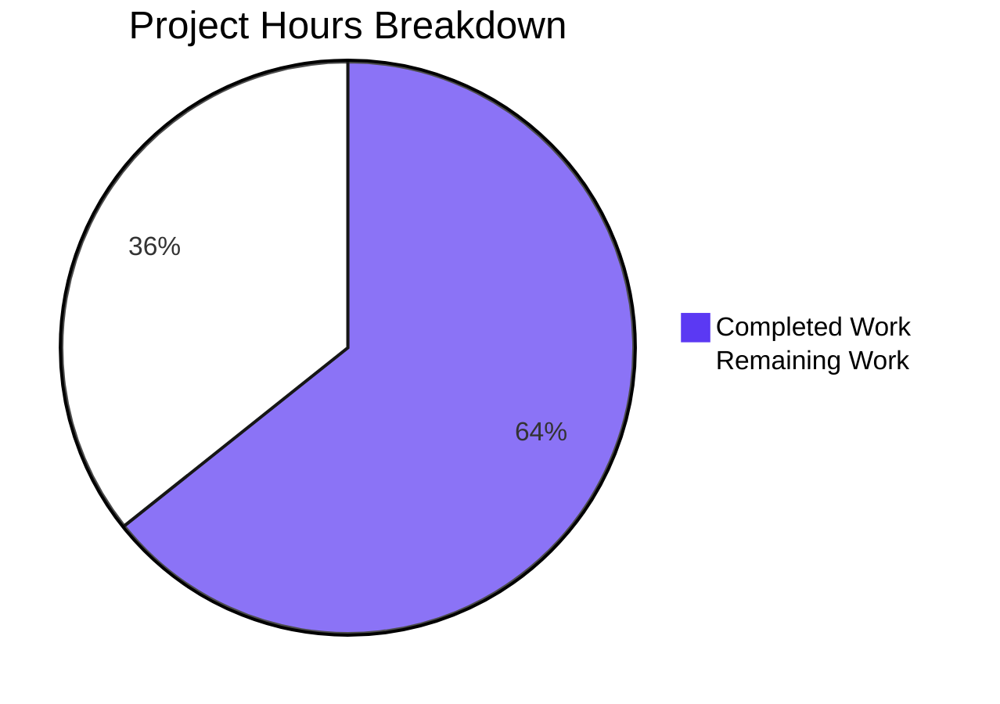

# 1. Executive Summary

## 1.1 Project Overview

This project delivers a single-endpoint Node.js HTTP service (`src/backend`) and one new observable behaviour: the process announces the bound address on standard output when the listener starts accepting connections — unconditionally, so a run under `NODE_ENV=test` still prints it. It also adds the two prerequisites for starting at all: the `/hello` handler module and the backend dependency manifest. Its audience is developers and operators running it directly or in the container image.

## 1.2 Completion Status

Every requirement the work was scoped against is delivered and verified: the six stated requirements (R1–R6), the five acceptance criteria (C1–C5) and the eight mapped artefacts. The remaining hours are path-to-production work, not unfinished requirement work.

**85.5 hours completed of 133.0 total = 64.3% complete** (85.5 ÷ 133.0).



*Completed work: Dark Blue (#5B39F3); remaining work: White (#FFFFFF). Centre value: **64.3% complete**.*

| Metric | Hours |
|---|---|
| Total Hours | 133.0 |
| Completed Hours (AI + Manual) | 85.5 |
| Remaining Hours | 47.5 |
| Percent Complete | 64.3% |

## 1.3 Key Accomplishments

- ✅ Startup announcement — one stdout line per listener start, naming the bound address (`src/backend/server.js:115`).
- ✅ Unconditional — emitted under `NODE_ENV=test` with the logger silent.
- ✅ Failure path — an address-in-use start announces nothing, adds no diagnostic, exits 1.
- ✅ `/hello` verified on the wire — 200, 404, 405 with `Allow: GET`, three security headers.
- ✅ Per-request logging unchanged — 2xx on stdout, 4xx on stderr.
- ✅ Deterministic install — `npm ci` resolves the runtime dependency from the lock file.
- ✅ Dependency-free acceptance tool — six checks against the real application, from process output.
- ✅ Coverage configuration and documentation updated, thresholds intact.

## 1.4 Critical Unresolved Issues

Open items: **8** — none is a scoped requirement; all 11 stated requirements and acceptance criteria and all eight delivered artefacts are complete and verified. The eight are the gaps to production.

| Issue | Impact | Owner | ETA |
|---|---|---|---|
| No runnable package test gate: 7 of 11 Jest suites fail on pre-existing source/test-contract mismatches and no test or coverage script is declared | No automated regression gate exists for the endpoint contract; a release gate cannot be built on `npm test` as it stands | Service owner | Sprint 1 |
| The per-request record writes the raw caller-supplied request target to stdout/stderr (`src/backend/utils/logger.js:133`) | A credential placed in a query string is persisted verbatim to the operator log; log volume can be inflated by a long target | Security owner | Sprint 1 |
| The local deployment configuration cannot start as written (`infrastructure/local/docker-compose.yml`: undefined dev command, pinned host port, `curl`-based health check) | A developer or operator following the compose path hits an immediate failure; the image path itself works | Platform owner | Sprint 1 |
| The documented health check is not executable in a fresh checkout (`infrastructure/scripts/health-check.sh` is mode 644) | The documented command fails with `Permission denied` until it is run as `bash <path>` or the mode is committed | Service owner | Sprint 2 |
| No delivery pipeline (`.github/workflows` does not exist) | The acceptance tool, the suite and the dependency audit are not run on every change | Platform owner | Sprint 2 |
| No `/health` or `/metrics` route, while the provisioned Prometheus/Grafana configuration scrapes both | Monitoring is inactive and an orchestrator has no liveness surface beyond `/hello` | Platform owner | Sprint 2 |
| Documentation drift: the README advertises `npm run dev/test/test:coverage/test:watch/lint/lint:fix/audit/audit:fix`, `.env.example` and a parallel Express implementation that do not exist; `LOG_LEVEL` is documented but filters nothing | A reader following the documentation hits missing-script errors and mis-set expectations | Service owner | Sprint 2 |
| An IPv6 host literal would be announced unbracketed (`http://::1:<port>`), a form not observed at runtime here | The announced address is not a well-formed URL if the service is ever bound to an IPv6 literal | Service owner | Backlog |

## 1.5 Access Issues

No access issues identified. The service is public and stateless: it needs no API, database or TLS credential and reaches no external service; its single dependency installs from the public npm registry using the committed lock file. Neither provisioned variable (`Dddd`, `Vebeh`) is used by any code.

## 1.6 Recommended Next Steps

1. **[High]** Restore the package test gate: realign the seven failing suites with the contracts the sources export.
2. **[High]** Bound or redact the caller-supplied request target in the per-request record.
3. **[Medium]** Make the local deployment configuration start and harden the backend image.
4. **[Medium]** Add a pipeline running the acceptance tool, the tests and the audit on a port-clean runner.
5. **[Medium]** Align the documented command surface and operational details with what ships.

# 2. Project Hours Breakdown

## 2.1 Completed Work Detail

Each row traces to a specific requirement or acceptance criterion of the delivered work.

| Component | Hours | Description |
|---|---|---|
| Startup announcement on the listener | 6.0 | The unconditional `console.log` inside `src/backend/server.js`'s `listen` callback beside the preserved `logServerStart` call: placement, the bound-address values, test-mode unconditionality, and absence on the bind-failure path (R1–R5, C1–C4). |
| `/hello` handler restoration | 5.0 | The module `src/backend/server.js:22` requires: `GET` returns `200` `text/plain` `Hello world` with the security headers; every other method delegates to the canonical 405 policy with `Allow: GET`; the module logs nothing of its own (C5). |
| Acceptance verification tool | 34.0 | `src/backend/scripts/verify-startup-log.js`: the runnable form of the acceptance criteria — a dependency-free harness of six checks that spawn the real application and read its streams and wire responses, with the PASS/FAIL/CONFLICT/PRECONDITION classification, usage guard, idempotence and cwd independence. |
| Backend manifest and generated lock file | 4.0 | The manifest that makes the runtime dependency resolvable and carries the two supported scripts, plus the generated lock the container image's install step consumes. |
| Coverage-configuration exclusion | 1.5 | The single `collectCoverageFrom` addition that keeps the non-application tool out of the measured surface, with every threshold, reporter and matcher intact. |
| Documentation of the new behaviour | 3.0 | The README passage covering the line, its unconditionality, the defaults and both verification commands, plus the changelog entry. |
| Acceptance verification of the delivered tree | 24.0 | The five criteria exercised by running the delivered application from process output: bound-address and defaults runs, test mode, the five-line development sequence, the address-in-use run, the endpoint and per-request-logging checks, on the host runtime and inside the built image. |
| Integration, compile/seam validation and dependency audit | 8.0 | The compile-equivalent check over every module, the module-loadability and relative-require seam sweep on the delivered tree, and the production-dependency audit. |
| **Total** | **85.5** | Matches Completed Hours in Section 1.2. |

## 2.2 Remaining Work Detail

Every row is path-to-production work for the service as a whole; no requirement of the delivered change is outstanding. The priorities match the task list in Section 8, and the sum matches Remaining Hours in Section 1.2 and the "Remaining Work" value in Section 7.

| Category | Hours | Priority |
|---|---|---|
| Restore the package test gate: realign the seven failing suites with the contracts the sources export and declare the test/coverage toolchain and scripts | 24.0 | High |
| Bound or redact the caller-supplied request target in the per-request record (`src/backend/utils/logger.js`, `src/backend/middleware/index.js`) | 6.0 | High |
| Make the local deployment configuration start (real entry-point command, unpinned host port, image-capable health check) and harden the backend image with a `.dockerignore` and a non-root user | 6.0 | Medium |
| Add a delivery pipeline running the acceptance tool, the package tests and the production-dependency audit on every change | 6.0 | Medium |
| Align the documented command surface with what ships, commit the executable bit on the health check, and activate or remove the inactive monitoring configuration | 4.0 | Medium |
| Make `LOG_LEVEL` filter the logger's records, or stop documenting it as a control | 1.5 | Low |
| **Total** | **47.5** | — |

Completed 85.5 hours + remaining 47.5 hours = 133.0 total project hours, of which 64.3% is complete. The completed figure is the recorded engineering work of the delivered change, including its verification; the remaining figure is limited to the deployment, testing and operational work needed to put the same service into production.

# 3. Test Results

Test inventory is aggregated by capability, and every figure below was measured on the delivered tree (`src/backend`, Node v22.23.4 / npm 11.21.0). A compile-equivalent syntax check over the nine modules of the running graph (`node --check`) passed with no failures.

| Area / Category | Framework | Tests | Passed | Failed | Coverage | What This Proves |
|---|---|---|---|---|---|---|
| Package unit and integration suite (11 suites) | Jest 29.7.0 + supertest, jest-junit reporter | 65 | 36 | 29 | Global 67.72% statements / 59.09% branches / 68% lines / 67.3% functions against thresholds 85/80/85/90; `handlers/hello.js` 100/100/100/100 | The passing suites (constants, canonical 404/405/500 handlers, the legacy hello handler) hold: the service's status codes, headers and messages are asserted where those suites match the sources. The 29 failures are pre-existing contract mismatches that reproduce identically without the delivered change. |
| Startup-announcement acceptance checks (`scripts/verify-startup-log.js`) | Node core harness, process output | 6 | 6 | 0 | Not measured — excluded from the instrumented surface by design | Each acceptance criterion holds when the real application is run: the line names the bound address, it names the documented defaults when `HOST`/`PORT` are unset, it survives `NODE_ENV=test` with the logger silent, the development startup sequence is preserved, the failure path announces nothing and exits 1, and the endpoint and per-request logging are unchanged. |
| Endpoint contract (`/hello`, unknown path, unsupported method) | Live HTTP requests plus the harness's C5 check | 3 status classes | 3 | 0 | `handlers/hello.js` 100/100/100/100 | `GET /hello` returns `200` `text/plain` with the exact 11-byte greeting and all three security headers; an unknown path returns `404` `Not Found`; any other method on `/hello` returns `405` with `Allow: GET` and body `Method Not Allowed`. |
| Per-request logging (format, level, stream routing) | Live HTTP requests, captured streams | 3 records | 3 | 0 | `utils/logger.js` 69.69% statements | 2xx records land on stdout at INFO, 4xx records on stderr at WARN, in the unchanged `<method> <url> <statusCode> <responseTime>ms` format, with the handler's own diagnostic preceding the middleware record. |
| Configuration resolution (explicit values, defaults, invalid values, boundary and padded values, `.env` precedence) | Live starts on distinct addresses, plus the harness's defaults check | 6 cases | 6 | 0 | `config.js` 83.33% statements | The announced address always equals the address actually bound: explicit values are used verbatim, an unset pair falls back to `0.0.0.0:3000`, out-of-range or non-numeric ports warn and fall back to 3000, and the process environment outranks a `.env` file. |
| Failure path and test-mode bootstrap | Live processes, exit status | 3 cases | 3 | 0 | `server.js` 83.67%, `index.js` 23.07% statements | A start on a held address prints no announcement, emits only the two existing error records and exits 1; `NODE_ENV=test node index.js` exits 0 without binding; and a test-mode start made in process still prints the announcement while the logger writes nothing. |
| Container path (image build, start, published port, documented health check) | Docker build and run, live HTTP requests | 4 checks | 4 | 0 | Not applicable — image content is not instrumented | The image builds from the delivered manifest and lock (`npm ci --only=production` executes), the container starts and serves `200` and `404` through its published port with the announcement in its logs, and the bundled health check passes inside it on the image's Node 18.20.8 runtime. |
| Dependency security gate | `npm audit --omit=dev --audit-level=high` | 1 gate | 1 | 0 | Not applicable | The production dependency tree — the single pinned `dotenv` 16.0.3 entry resolved from the committed lock — carries no known advisories. |

**Not Covered**

- **No passing automated test asserts the `/hello` contract.** The contract is exercised by the acceptance tool and on the wire, but the corresponding Jest suite fails on a pre-existing expectation that the handler log, which the handler must not do. Before release, add suite coverage for 200/404/405, the three security headers, the exact body length and the 405 `Allow` header, so the contract is guarded by the package gate rather than by a manual run.
- **No automated test covers the service's server-lifecycle exports or the legacy module chain.** Seven suites fail on references to exports the sources never provided, so the areas they are meant to cover — bind/stop behaviour, the request-logging helper API, the bootstrap exit paths and the unwired second `/hello` chain — have no passing coverage at all.
- **The 500 path has no automated test.** The generic `Internal Server Error` response and the absence of internal detail in the body were exercised at runtime only (a malformed absolute-form request target), not asserted by any suite.
- **The acceptance tool is not measured by coverage** — deliberately, so it is not counted as application code; its own correctness rests on the checks being observed to fail when the behaviour is withheld.
- **No automated load, soak or concurrency test exists.** Concurrency evidence is limited to a manual wave of 20 concurrent requests, all answered `200`, with the announcement still emitted exactly once.
- **No test covers the deployment and operations surface**: the compose configuration, the monitoring configuration, the health-check script's executable mode and the container image's non-root hardening are not exercised by anything.
- **An IPv6 host literal is not covered.** The announced form for such a value could not be observed on this host (no IPv6 loopback), so the behaviour of `HOST='::1'` is untested.

# 4. Runtime Validation &amp; UI Verification

Every line below was driven against a running service; the flows are the ones the delivered behaviour touches. There is no user-facing surface to verify: the checkout contains no HTML, template, style or client-side asset, so no browser-based check applies and every observation is process output, an HTTP response or an exit status.

- ✅ **Service start and startup output** — `node index.js` and `npm start` both reach the listening state and print exactly five stdout lines in order (`.env` notice, `Starting Node.js Hello World application...`, `Server started on 127.0.0.1:21945`, `Server listening at http://127.0.0.1:21945`, `Application startup complete.`), with stderr empty at start.
- ✅ **Startup announcement on the bound address** — the line names the address the socket actually bound in every configuration exercised; the announced address answers `GET /hello` with `200`, and the announcement stays at exactly one line across requests and connections.
- ✅ **Startup announcement under test mode** — a test-mode start made in process prints the line with the logger completely silent (stderr 0 bytes) and the announced address serves `200`; `NODE_ENV=test node index.js` exits 0 without binding, as the bootstrap guard intends.
- ✅ **Defaults run** — with `HOST` and `PORT` unset the line reads `Server listening at http://0.0.0.0:3000` and the service answers on the loopback address of that port.
- ✅ **Bind-failure path** — a second process on a held address prints no announcement, writes only the two existing error records (`Server error: listen EADDRINUSE ...` and `Failed to start application: listen EADDRINUSE ...`) and exits 1, while the holder keeps serving `200`.
- ✅ **Graceful shutdown** — `SIGTERM` logs `SIGTERM signal received. Shutting down server...` then `Server stopped`, the process exits 0 and the port is released; no orphan process remained after any run.
- ✅ **Endpoint contract** — `GET /hello` returns `200` `text/plain`, `Content-Length: 11`, body `Hello world`, with `X-Content-Type-Options: nosniff`, `X-Frame-Options: DENY` and `Content-Security-Policy: default-src 'none'`; an unknown path returns `404 Not Found`; `POST /hello` returns `405 Method Not Allowed` with `Allow: GET`, each carrying the same three headers. The 500 class was reached at runtime with a malformed absolute-form target and returned the generic body with no stack frame, path or exception class in it.
- ✅ **Per-request logging and stream routing** — `INFO: GET /hello 200 0ms` on stdout for 2xx, `WARN: GET /nope 404 0ms` and `WARN: POST /hello 405 0ms` on stderr for 4xx, with the handler's own diagnostic preceding the record and the format unchanged.
- ✅ **Container path** — the image builds from the delivered manifest and lock (`npm ci --only=production` executes, `found 0 vulnerabilities`), the container starts and serves `200` and `404` through its published port with the announcement in its logs, the bundled health check passes inside it, and the in-image runtime is the documented Node 18.20.8.
- ⚠ **Operational stacks — not exercised** — the local compose stack was never started and cannot start as written (undefined dev command, host-pinned port, `curl`-based health check), and the provisioned Prometheus/Grafana configuration stays inactive because the routes it scrapes do not exist.

**Never exercised at runtime:** the compose stack and the monitoring stack above; an IPv6 host literal (the announced form for such a value could not be observed on this host, which has no IPv6 loopback); TLS, CORS, authentication, authorisation, sessions and rate limiting (no such mechanism exists in the application, so there is no surface to drive); and the eight npm scripts the manifest deliberately does not define, which fail with a missing-script error by design. The health-check script was run through the shell rather than executed directly, because it is not marked executable in the checkout.

# 5. Compliance &amp; Quality Review

## 5.1 Compliance Matrix

Each row is a delivered artefact or behaviour measured against the benchmark that governs it, in the state it is in now.

| Deliverable | Governing Benchmark | Status | Progress |
|---|---|---|---|
| Startup announcement on the listener (R1–R3) | Functional correctness observed from process output | ✅ Pass | 100% |
| Additive change with preserved startup output (R4, C3) | Non-regression of existing observable behaviour | ✅ Pass | 100% |
| Bind-failure behaviour and exit status (R5, C4) | Correct failure semantics and non-zero exit | ✅ Pass | 100% |
| Adjacent contract and per-request logging (C5) | Endpoint contract integrity and log-format stability | ✅ Pass | 100% |
| `/hello` handler module restoration | Startability and dependency resolution of the entry point | ✅ Pass | 100% |
| Backend manifest and generated lock file | Reproducible dependency install (`npm install`, `npm ci`) | ✅ Pass | 100% |
| Acceptance verification tool | Self-checking verification artefact with no external dependency; fails when the behaviour is withheld | ✅ Pass | 100% |
| Coverage configuration | Measurement integrity — thresholds, reporters and matchers unchanged | ✅ Pass | 100% |
| Documentation of the new behaviour | Accuracy of the README passage and changelog entry against observed runtime | ✅ Pass | 100% |
| Repository conventions and dependency discipline | CommonJS, JSDoc on exports, formatting, one pinned runtime dependency | ✅ Pass | 100% |
| Package test gate | An automated regression gate that runs where the contract lives | ❌ Fail | 36 of 65 tests pass; none of the failures is attributable to the delivered change — pre-existing and outside the delivered scope |
| Deployment and operational readiness | Buildable, startable, health-checked and observable in production | ⚠ Partial | Image path verified end to end; the compose configuration, the health-check executable bit, the monitoring routes and log hygiene remain open |

## 5.2 AAP & Rule Divergences and Gaps

Every departure from the agreed plan or the user's rules is listed. No user rules were provided for this project, so no rule departure exists; each row below is a departure from the plan, with the reason it happened and what remains for a human.

| What the Plan/Rule Required | What Was Delivered Instead | Why It Diverged | Impact | Remediation |
|---|---|---|---|---|
| The acceptance tool should "print one PASS/FAIL line per check ... and exit 0 when everything passes and 1 otherwise" | Four verdict classes — `PASS`, `FAIL`, `CONFLICT` and `PRECONDITION` — one per check, plus exit status 2 for a usage error, with a tally counting conflicted and unobserved checks separately | Two of the six checks depend on the machine they run on: one needs four specific addresses free, and one needs the declared dependency installed. A `.env` that sets `HOST` or `PORT` also decides the address the defaults check would observe. Reporting any of those as a criteria failure would blame the service for its environment | A consumer parsing strictly for PASS/FAIL, or accepting only exits 0 and 1, must handle two extra verdict words and exit 2; the exit contract's substance holds (exit 0 only when every check passed) | None for release; the tool's usage output documents the vocabulary and the exit contract, so the acceptance criteria should be read as extended by those two classes |
| Application runs must use the clone's own port partition and never the default 3000 | The acceptance tool binds `127.0.0.1:3100`, the documented default `0.0.0.0:3000`, `127.0.0.1:31002` and `127.0.0.1:31003` while it runs | The acceptance criteria name those four addresses and require each criterion to be observed at the address it names, so they are not substitutable; the tool probes them up front and reports a held address as a conflict rather than a failure | A gate run on a host where one of those four addresses is busy stands down with exit 1 instead of passing — it fails safe and never false-passes | Ensure the four addresses are idle before a run; the pipeline task in Section 2.2 places the gate on a runner where they are |
| Acceptance evidence should be produced on Node.js 18.20.8, the version the repository documents | All host evidence was produced on the host runtime, Node v22.23.4 with npm 11.21.0; the documented 18.x runtime was exercised inside the built container image (`node v18.20.8`, npm 10.8.2) | **Sanctioned** — the user's setup instructions for this environment mandate the host runtime and forbid installing anything below 20.20.2 / 22.12.0, which overrides the documented version | None functional: the change uses `console.log`, Node core APIs and a dependency that supports Node 12 and above; the repository's documents still name 18.x while the images pin `node:18-alpine`, which is a documentation matter | Folded into the documentation alignment in Section 2.2: state the supported runtime line the environment actually permits |
| The address-in-use criterion describes `Error starting server` as the existing output of the failure path, and lists it among the literals to preserve | The failure path prints `Server error: listen EADDRINUSE ...` and `Failed to start application: listen EADDRINUSE ...` with their stacks; `Error starting server` remains only in the synchronous catch it belongs to, which the asynchronous bind failure cannot reach | **Sanctioned** — the plan itself states this: the literal is unreachable from the asynchronous error event, and no diagnostic may be added or reworded to make it appear | A reader matching the criterion's quoted literal against captured output will not find it; the criterion's substance holds — no announcement, no new diagnostic, exit 1 | None; the behaviour is the one the plan prescribes |
| The pre-existing suites are neither edited nor repaired, and the change claims no green package run | The suites are exactly as they were: 7 of 11 fail on source/test-contract mismatches, unchanged by the delivered work, and the manifest declares no test or coverage script | **Sanctioned scope boundary** — the plan places suite repair outside the delivered change and the manifest deliberately carries only the two supported scripts, so declaring a test toolchain would have contradicted it | The project has no runnable package test gate; the endpoint contract is guarded only by the acceptance tool and manual runs, so a regression could pass unnoticed | Section 2.2, first row (24.0 h): realign the failing suites with the contracts the sources export and declare the toolchain and scripts so the gate runs again |

**D-1 — the acceptance tool's verdict vocabulary.** The tool prints a single verdict line per check, as agreed, but the vocabulary is wider than the two words the plan named. The reason is substantive rather than cosmetic: two of the six checks depend on the machine they run on — one needs four specific addresses free, and one needs the declared dependency installed — and a `.env` file that sets `HOST` or `PORT` decides the address the defaults check would observe. Reporting those as criteria failures would blame the service for its environment. The delivered tool therefore prints `CONFLICT` with exit 1 when an address it needs belongs to another process, and `PRECONDITION` when a criterion was never observable, counting both separately from failures in its tally (`src/backend/scripts/verify-startup-log.js:109-110`, `:959`, `:962`, `:1523-1542`). The decision for the reader is only whether to adopt that wider vocabulary in the project's own acceptance criteria; nothing about the service changes.

**D-2 — the addresses the acceptance tool binds.** The delivered tool binds four fixed addresses while it runs: `127.0.0.1:3100` for the bound-address checks, the documented default `0.0.0.0:3000` for the defaults check, `127.0.0.1:31002` for the development run and the requests it makes, and `127.0.0.1:31003` for the address-in-use check (`src/backend/scripts/verify-startup-log.js:68-71`, `:94`). Those addresses come from the acceptance criteria, which require each criterion to be observed where it names it, so substituting a port would weaken the evidence rather than relocate it. The consequence is operational: on a busy machine a legitimate gate run stands down with a conflict and a non-zero exit, which is fail-safe but not green. All four addresses were verified free before and after every run recorded here; the pipeline work in Section 2.2 exists in part to make that guaranteed.

**D-3 — the runtime the evidence was produced on.** The repository documents Node.js 18.x and the plan named 18.20.8 as the evidence runtime. Every measurement recorded in this guide was produced on the host runtime, Node v22.23.4 with npm 11.21.0, because the environment's own instructions mandate the host runtime and forbid installing anything below 20.20.2 or 22.12.0. This is a sanctioned departure, and it costs nothing in substance: the change uses `console.log`, Node core APIs and a single runtime dependency that supports Node 12 and above, no part of the delivered behaviour is version-sensitive, and the documented runtime was exercised anyway — inside the built image the process runs `node v18.20.8` and prints the announcement. What remains is documentation: the repository's files should name a runtime line that the environments running it can actually install.

**D-4 — the failure-path literal.** The plan's address-in-use criterion quotes `Error starting server` as the existing output of the failure path and lists it among the literals to preserve. The delivered service prints `Server error: listen EADDRINUSE ...` and `Failed to start application: listen EADDRINUSE ...` with their stacks instead, and the quoted literal exists only in the synchronous catch inside `src/backend/server.js`, which an asynchronous bind failure never reaches. The plan states this itself, and forbids adding or rewording a diagnostic to make the quoted string appear. Nothing is required of the reader: the criterion's substance is verified in full — no announcement on the failure path, no new diagnostic, exit status 1 — and the two records that are printed are the ones the service always produced.

**D-5 — the package test gate.** Seven of the eleven Jest suites fail on pre-existing contract mismatches: they import server-lifecycle exports the sources never provided, call logger helpers that do not exist, require configuration at the wrong depth, and expect the `/hello` handler to log when it must not. The plan places their repair outside the delivered change and the manifest deliberately declares only `start` and `verify:startup`, so the suites are exactly as red after the change as before it — verified by comparing a pristine tree against the delivered one. The divergence is the boundary itself: the project therefore has no runnable package test gate at all, and the endpoint contract is guarded only by the acceptance tool and by manual runs. Section 2.2 carries the work to close it (24.0 hours) and Section 1.4 lists it as the first open item; until it is done, treat a `npm test` run as uninformative rather than failing.

# 6. Risk Assessment

Risks are forward-looking — what could still go wrong once this service runs outside a developer machine. Only what remains unresolved appears here.

| Risk | Category | Severity | Probability | Mitigation | Status |
|---|---|---|---|---|---|
| No automated regression gate exists: seven of eleven Jest suites fail on pre-existing contract mismatches and the manifest declares no test or coverage script, so nothing guards the endpoint contract | Technical | Medium | High — present today | Realign the failing suites with the contracts the sources export and declare the test toolchain, running the acceptance tool as the interim gate (Section 2.2, first row) | Open |
| The per-request record interpolates the raw caller-supplied request target (`src/backend/utils/logger.js:133` via `src/backend/middleware/index.js:36`), so a credential placed in a query string is persisted verbatim to stdout or stderr, and one long target can inflate a record | Security | Medium | Medium | Log the pathname rather than the raw target, or redact sensitive query keys, and cap the logged length; line forging is already impossible because the HTTP parser rejects raw CR/LF/ESC with 400 | Open — accepted risk requiring its own change |
| The acceptance tool must bind four fixed addresses (`127.0.0.1:3100`, `0.0.0.0:3000`, `127.0.0.1:31002`, `127.0.0.1:31003`), so on a busy host a gate run stands down instead of passing | Operational | Low | Medium | Run it where those four addresses are idle — it probes them before the first check and documents them in its usage output — and never beside a sibling service on the default port | Open — by design; fails safe, never false-passes |
| The local deployment configuration cannot start: `infrastructure/local/docker-compose.yml` pins the host-global container name and port 3000, runs an undefined dev command, and its health check requires `curl`, which the image does not ship | Integration | Medium | High | Run the entry point directly, parameterise the published port, and replace the health check with the bundled script or a node one-liner; the backend image itself builds and runs correctly | Open |
| The documented health check is tracked mode 644, so it is not executable in a fresh checkout, and the backend image ships no `.dockerignore` and runs as root | Operational | Low | High | Commit the executable bit (or document `bash <path>` until then); add a `.dockerignore` and a non-root `USER` to the image | Open |
| The service exposes no `/health` or `/metrics` route while the provisioned monitoring configuration scrapes both, leaving monitoring inactive and an orchestrator without a liveness surface beyond the `/hello` contract | Operational | Low | High | Add a liveness route, and a metrics endpoint if the monitoring stack is to be activated — or deactivate and remove the unused configuration | Open |
| The documented command surface and configuration disagree with what ships: the README advertises eight npm scripts, a sample environment file and a parallel Express implementation that do not exist, and `LOG_LEVEL` is documented as a logging control while the logger filters only on test mode | Technical | Low | Medium | Align the README with the delivered scripts and either implement `LOG_LEVEL` filtering or drop the claim | Open |
| Bind-failure diagnostics carry Node stack traces and absolute file paths on stderr (pre-existing, developer-facing) | Security / Operational | Low | Medium | Route startup output to a developer-facing destination, or trim the stacks if these logs are shipped to a shared or persisted sink | Open |

**Not recorded as risks:** the absence of authentication, authorisation, sessions, CORS, CSRF, transport security and rate limiting. The service serves one constant, accepts no input on any route and holds no data, so those controls have no surface to protect rather than being missing; the same applies to database and ORM injection, which cannot occur because no data store exists.

# 7. Visual Project Status

Progress and remaining effort, in the same figures as Section 1.2.


*Completed work is Dark Blue (#5B39F3); remaining work is White (#FFFFFF). Centre value: **64.3% complete** — 85.5 hours of 133.0.*

Remaining hours by category, in priority order:

| Category | Hours | Share of Remaining |
|---|---|---|
| Restore the package test gate | 24.0 | 50.5% |
| Bound or redact the caller-supplied request target | 6.0 | 12.6% |
| Make the local deployment configuration start and harden the image | 6.0 | 12.6% |
| Add a delivery pipeline | 6.0 | 12.6% |
| Align the documented and operational surface | 4.0 | 8.4% |
| Make `LOG_LEVEL` filter records or stop documenting it | 1.5 | 3.2% |
| **Total** | **47.5** | **100%** |

Priority distribution of the remaining work: **30.0 hours High** (the test gate and the log-hygiene exposure), **16.0 hours Medium** (deployment configuration, pipeline, documentation and operational alignment), **1.5 hours Low**.

# 8. Summary &amp; Recommendations

The delivered change makes this service announce the address it bound on standard output at the moment the listener starts, unconditionally, and it adds the two prerequisites for the service starting at all: the `/hello` handler module and the backend dependency manifest. What the reader can rely on is verified rather than asserted: the announcement is emitted exactly once per listener start on the bound address, it survives `NODE_ENV=test` while the logger is silent, it is additive beside the existing `Server started on <host>:<port>` line, it is absent on the bind-failure path with the exit status unchanged, and the endpoint contract and per-request logging are untouched. A dependency-free acceptance tool (`src/backend/scripts/verify-startup-log.js`) reproduces all six checks from the real process's output and exited 0 on the delivered tree, the endpoint contract was exercised on the wire (200, 404 and 405 with their headers and bodies), the container path was built and run on the image's documented Node 18.20.8 runtime with the bundled health check passing, and the production dependency audit reported no advisories.

**85.5 hours of work are complete out of 133.0 total — 64.3% — and every requirement the work was scoped against is delivered and verified.** The remaining 47.5 hours are path-to-production work for the service as a whole rather than unfinished requirement work: restoring a runnable package test gate (24.0), bounding the caller-supplied request target before it reaches the log (6.0), making the local deployment configuration start and hardening the image (6.0), adding a delivery pipeline (6.0), aligning the documented and operational surface (4.0), and deciding what `LOG_LEVEL` should do (1.5).

The critical path runs through two items. First, **the package test gate**: seven of eleven suites fail on contract mismatches that predate this work, and no test script is declared, so a regression in the endpoint contract would pass unnoticed; bringing those suites back onto the contracts the sources actually export is the single largest remaining item and the one that makes every later change safer. Second, **log hygiene**: the per-request record writes the caller-supplied request target verbatim, so a credential placed in a query string is persisted to whichever stream that status class logs to. Line forging is already impossible — the HTTP parser rejects raw CR and LF with a 400 before dispatch — but disclosure and log inflation are not. Everything else on the list unblocks or tidies deployment rather than the service's correctness.

The metrics that define success are all met: six of six acceptance checks pass with exit 0 and an empty stderr; the announcement names the address that answers in every configuration exercised, from explicit values through defaults to out-of-range inputs; the endpoint contract returns the exact 11-byte body with all three security headers on every status class it serves; the failure path announces nothing and still exits 1; and the production dependency tree is clean. Against those, the unresolved items are bounded and named: one red gate, one accepted logging exposure, and a deployment surface that cannot run as written.

**Production readiness: ready for the behaviour it delivers, with the caveats above.** As a single stateless container the service builds, starts, serves and health-checks correctly, holds no data, accepts no input and needs no credentials. Do not put it behind a shared log sink before the request-target exposure is fixed, and do not build a release gate on `npm test` until the suites are realigned. Recommended order of work: the test gate, the log-hygiene fix, then the deployment configuration and the pipeline, then the documentation and operational tidy-up.

# 9. Development Guide

Everything below was run against the delivered tree on Node v22.23.4 / npm 11.21.0. Paths are given from the service directory; the repository holds the project as `hao-backprop-test-main (1)/hao-backprop-test-main`.

## System Prerequisites

- **Node.js 22.12.0 or higher (or 20.20.2+)** — the environment's runtime policy; the host installation is v22.23.4. The repository's documents name Node 18.x LTS and the container images pin `node:18-alpine`; do **not** install Node 18.x on a machine governed by that policy.
- **npm** — 11.21.0 on the host, 10.8.2 inside the image. No other package manager is needed.
- **No database, cache, message broker or external service.** The service is a single stateless process; its only runtime dependency is resolved from the public npm registry.

## Environment Setup and Install

```bash
# From the repository root; the project path contains a space and parentheses, so quote it
PRJ="hao-backprop-test-main (1)/hao-backprop-test-main"
cd "$PRJ/src/backend"

# Deterministic install from the committed manifest and lock file
CI=true npm ci --no-audit --no-fund        # -> added 1 package; dotenv 16.0.3
# or, if you change the manifest:
CI=true npm install --no-audit --no-fund
```

There is no build step: plain CommonJS, no TypeScript, bundler, transpiler or build script. The compile-equivalent for a change is a syntax check:

```bash
cd "$PRJ/src/backend" && node --check server.js && node --check index.js
```

## Configuration

| Variable | Default | Notes |
|---|---|---|
| `PORT` | 3000 | Out-of-range or non-numeric values warn and fall back to 3000; the announced address is always the address bound |
| `HOST` | 0.0.0.0 | `127.0.0.1` is recommended for local runs |
| `NODE_ENV` | development | `test` suppresses the logger and, on the entry point, does not start a listener at all |
| `LOG_LEVEL` | INFO | Documented but inert: the logger filters only on test mode |

A `src/backend/.env` file is optional and is loaded if present; process environment variables take precedence over it. No `.env.example` ships.

## Starting the Service

```bash
cd "$PRJ/src/backend"

# Direct entry point (recommended: signals reach the server)
HOST=127.0.0.1 PORT=21945 NODE_ENV=development node index.js

# Through the declared script
HOST=127.0.0.1 PORT=21945 NODE_ENV=development npm start
```

Expected stdout, in order, with stderr empty at start:

```text
No .env file found or unable to read it. Using default values and environment variables.
[2026-11-05T10:10:13.795Z] INFO: Starting Node.js Hello World application...
[2026-11-05T10:10:13.802Z] INFO: Server started on 127.0.0.1:21945
Server listening at http://127.0.0.1:21945
[2026-11-05T10:10:13.802Z] INFO: Application startup complete.
```

Stop with `Ctrl-C` or `SIGTERM`; the service logs `SIGTERM signal received. Shutting down server...` and `Server stopped`, exits 0 and releases the port. Because `npm start` runs the script through an intermediate shell, signal the process that owns the port rather than the npm wrapper.

To observe the announcement under test mode, where the entry point deliberately does not start a listener:

```bash
cd "$PRJ/src/backend" && NODE_ENV=test HOST=127.0.0.1 PORT=21946 \
  node -e "require('./server').startServer();"
```

## Example Usage and Verification

```bash
# The documented endpoint
curl -s -i http://127.0.0.1:21945/hello
# HTTP/1.1 200 OK, Content-Type: text/plain, Content-Length: 11, body: Hello world
# plus X-Content-Type-Options: nosniff, X-Frame-Options: DENY,
# Content-Security-Policy: default-src 'none'

curl -s -i http://127.0.0.1:21945/nope      # 404, body Not Found
curl -s -i -X POST http://127.0.0.1:21945/hello   # 405, Allow: GET, body Method Not Allowed

# The bundled health check (invoke through bash: it is not executable in a fresh checkout)
bash ../infrastructure/scripts/health-check.sh --host 127.0.0.1 --port 21945
# -> Health check passed! Service is responding correctly.   (exit 0)

# The acceptance checks for the startup behaviour
cd "$PRJ/src/backend" && node scripts/verify-startup-log.js
# PASS C1a, C1b, C2, C3, C4, C5
# 6 checks passed, 0 failed, 0 conflicted, 0 unobserved   (exit 0)
npm run verify:startup        # the same script through the package
```

The acceptance tool observes each criterion where it is named, so it needs four addresses free while it runs: `127.0.0.1:3100`, the documented default `0.0.0.0:3000`, `127.0.0.1:31002` and `127.0.0.1:31003`. An address another process holds is reported as `CONFLICT` and a criterion the environment never allowed to be observed is reported as `PRECONDITION`, both with a non-zero exit; neither is reported as a failure of the service.

## Running the Test Suite

The delivered manifest declares no test or coverage script, so the runner must be invoked directly:

```bash
cd "$PRJ/src/backend" && CI=true npx jest --config jest.config.js --ci --runInBand --coverage
```

Current state: exit 1, **7 failed / 4 passed suites, 29 failed / 36 passed of 65 tests**, global coverage 67.72% statements / 59.09% branches / 68% lines / 67.3% functions against thresholds 85/80/85/90 — while `handlers/hello.js` measures 100/100/100/100. Every failure is a pre-existing contract mismatch that reproduces without the delivered change; see Section 2.2 for the work to realign them.

## Docker and Deployment

```bash
# Build and run the backend image (its install step consumes the committed lock file)
docker build -t hello-world-backend src/backend
docker run --rm -p 127.0.0.1:21950:3000 -e HOST=0.0.0.0 -e PORT=3000 hello-world-backend
curl -s http://127.0.0.1:21950/hello     # Hello world
```

The image builds and runs correctly. Do **not** use `infrastructure/local/docker-compose.yml` as written: it pins the host-global container name and port 3000, runs a dev command the manifest does not define, and its health check requires `curl`, which `node:18-alpine` does not ship.

## Troubleshooting

- **`Cannot find module 'dotenv'`** — dependencies are not installed. Run `cd src/backend && npm install`.
- **`Error: listen EADDRINUSE: address already in use <host>:<port>`** — another process holds the address. The run prints no startup line, writes only `ERROR: Server error: ...` and `ERROR: Failed to start application: ...` and exits 1. Choose a free port; the acceptance tool's four criterion addresses must also be idle before a run.
- **No startup line from `NODE_ENV=test node index.js`** — expected: the bootstrap guard does not start a listener in test mode. Use the in-process form above.
- **`Invalid port: <value>. Using default port: 3000` on stderr** — the supplied `PORT` was non-numeric or out of range and the service started on 3000; the announcement names the port actually bound.
- **`npm error Missing script`** for `dev`, `test`, `test:coverage`, `test:watch`, `lint`, `lint:fix`, `audit` or `audit:fix` — by design: the manifest declares only `start` and `verify:startup`.
- **`.env` changes the announced address, and the acceptance tool reports `PRECONDITION` for the defaults check** — expected: a `.env` that sets `HOST` or `PORT` decides the address, so the defaults criterion is reported as unobserved rather than failed. The tool never edits that file.
- **`Permission denied` running `infrastructure/scripts/health-check.sh`** — the script is not marked executable in the checkout; run it as `bash <path>` or commit the executable bit.

# 10. Appendices

## A. Command Reference

Run every command from the service directory: `cd "hao-backprop-test-main (1)/hao-backprop-test-main/src/backend"`.

| Purpose | Command |
|---|---|
| Install dependencies (deterministic) | `CI=true npm ci --no-audit --no-fund` |
| Install dependencies (after a manifest change) | `CI=true npm install --no-audit --no-fund` |
| Syntax check a changed file (no build step exists) | `node --check <file>` |
| Start the service | `HOST=127.0.0.1 PORT=21945 NODE_ENV=development node index.js` |
| Start through the declared script | `HOST=127.0.0.1 PORT=21945 npm start` |
| Start in test mode, in process | `NODE_ENV=test HOST=127.0.0.1 PORT=21946 node -e "require('./server').startServer();"` |
| Check the endpoint | `curl -s -i http://127.0.0.1:21945/hello` |
| Check the unknown-path and method paths | `curl -s -i http://127.0.0.1:21945/nope` and `curl -s -i -X POST http://127.0.0.1:21945/hello` |
| Run the acceptance checks | `node scripts/verify-startup-log.js` or `npm run verify:startup` |
| Show the acceptance tool's usage | `node scripts/verify-startup-log.js --help` |
| Run the bundled health check (through the shell) | `bash ../infrastructure/scripts/health-check.sh --host 127.0.0.1 --port 21945` |
| Run the package test suite | `CI=true npx jest --config jest.config.js --ci --runInBand --coverage` |
| Audit production dependencies | `npm audit --omit=dev --audit-level=high` |
| Build and run the container image | `docker build -t hello-world-backend src/backend` then `docker run --rm -p 127.0.0.1:21950:3000 hello-world-backend` |

Commands the manifest deliberately does not define — `npm run dev`, `npm test`, `npm run test:coverage`, `npm run test:watch`, `npm run lint`, `npm run lint:fix`, `npm run audit`, `npm run audit:fix` — each exit 1 with a missing-script error.

## B. Port Reference

| Port | Used By | Notes |
|---|---|---|
| 3000 | Service default (`PORT` unset) and the container's documented port | The acceptance tool's defaults check binds `0.0.0.0:3000`, so it must be free for a fully green run |
| 3100 | Acceptance tool, bound-address check | `127.0.0.1:3100`, the address the criteria name |
| 31002 | Acceptance tool, development-run check and its request checks | `127.0.0.1:31002`; held from the development check until the request checks complete |
| 31003 | Acceptance tool, address-in-use check | `127.0.0.1:31003` |
| 21945–21950 | Examples in this guide only | Free choices for local runs, the container's published port and the health check |

## C. Key File Locations

| Path | Contents |
|---|---|
| `src/backend/server.js` | Listener lifecycle; the startup announcement is line 115, inside the `listen` callback |
| `src/backend/index.js` | Entry point, startup messages, graceful shutdown, test-mode bootstrap guard |
| `src/backend/config.js` | Configuration resolution, `.env` loading, port validation and defaults |
| `src/backend/handlers/hello.js` | The `/hello` handler: 200 with the greeting, non-GET delegating to the 405 policy |
| `src/backend/handlers/error.js` | Canonical 404, 405 and 500 responses |
| `src/backend/middleware/index.js` | Per-request logging trigger and the three security headers |
| `src/backend/utils/logger.js` | Logger helpers, the per-request record format, test-mode suppression |
| `src/backend/utils/constants.js` | Status codes, headers, route map and message constants |
| `src/backend/scripts/verify-startup-log.js` | The acceptance checks (six, with the conflict and precondition classes) |
| `src/backend/__tests__/` | The Jest suites and their setup file |
| `src/backend/jest.config.js` | Test matching, coverage collection and thresholds |
| `src/backend/package.json`, `src/backend/package-lock.json` | Runtime dependency and the two declared scripts |
| `src/backend/Dockerfile` | Backend image (`node:18-alpine`, `npm ci --only=production`) |
| `src/backend/README.md`, `src/backend/CHANGELOG.md` | Documentation of the behaviour and its verification commands |
| `infrastructure/scripts/health-check.sh` | Bundled endpoint health check (mode 644; run through `bash`) |
| `infrastructure/local/docker-compose.yml` | Local orchestration — cannot start as written (see Section 6) |
| `infrastructure/monitoring/` | Prometheus and Grafana configuration for endpoints that do not exist yet |

## D. Technology Versions

| Component | Version |
|---|---|
| Node.js (host, all recorded evidence) | v22.23.4 |
| Node.js (inside the built image) | v18.20.8 |
| npm | 11.21.0 host, 10.8.2 in image |
| Runtime dependency | `dotenv` 16.0.3 (exact, the only dependency) |
| Test toolchain used to run the suite | Jest 29.7.0, supertest 6.3.4, jest-junit 17.0.0 — installed outside the manifest, which declares none of them |
| Acceptance tool dependencies | Node core modules only (`child_process`, `http`, `path`) |
| Container | Docker Engine with the `docker compose` v2 plugin (`docker-compose` legacy script not used) |

## E. Environment Variable Reference

| Variable | Default | Read By | Effect |
|---|---|---|---|
| `PORT` | 3000 | `src/backend/config.js` | Port the listener binds; invalid values warn and fall back to 3000 |
| `HOST` | 0.0.0.0 | `src/backend/config.js` | Address the listener binds; `127.0.0.1` is recommended for local runs |
| `NODE_ENV` | development | `src/backend/config.js`, `src/backend/index.js`, `src/backend/utils/logger.js` | Selects the environment; `production` suppresses the `.env` notice, `test` silences the logger and prevents the entry point from binding |
| `LOG_LEVEL` | INFO | `src/backend/config.js` | Documented, currently inert — the logger filters only on test mode |
| `Dddd`, `Vebeh` | unset | nothing | Provisioned with the request and consumed by no code; leave them alone |

## F. Developer Tools Guide

- **Watch mode:** not available. The manifest defines no `dev` script and `nodemon` is not installed, although `src/backend/nodemon.json` describes a watch configuration. Restart the process by hand while developing.
- **Running one suite:** `CI=true npx jest --config jest.config.js --ci --runInBand __tests__/<name>.test.js` (add `--coverage=false` for a faster loop).
- **Reading the startup behaviour without the harness:** start the service with a chosen `HOST`/`PORT` and read its stdout; the announcement is the fourth line of a development start and the last line of a test-mode in-process start.
- **Isolating a port conflict:** the acceptance tool reports the holder as a `CONFLICT` line naming the address and the `EADDRINUSE` message; free the address and rerun rather than editing the tool, whose addresses come from the acceptance criteria.
- **Checking whether a change is additive:** the announcement is one statement inside the `listen` callback; keep it the fourth line of the development sequence and keep the logger's `Server started on <host>:<port>` line and the per-request record format untouched, then rerun the acceptance checks.
- **Container debugging:** the image's stdout carries the announcement, the two error records go to stderr, and the in-image runtime is Node 18.20.8; `docker logs <container>` shows both streams.

## G. Glossary

| Term | Meaning |
|---|---|
| **Startup announcement** | The single stdout line `Server listening at http://<host>:<port>` printed when the listener starts binding, unconditionally, including under `NODE_ENV=test` |
| **Bound address** | The `HOST`/`PORT` pair the socket actually bound, which is what the announcement prints |
| **Acceptance tool** | `src/backend/scripts/verify-startup-log.js`, the dependency-free harness that runs six checks against the real application and asserts from process output |
| **C1a / C1b** | The bound-address and defaults readings of the announcement criterion |
| **C2 / C3 / C4 / C5** | The test-mode, preserved-startup-output, failure-path and adjacent-contract checks |
| **`CONFLICT`** | The tool's verdict when an address a check needs belongs to another process — not a failure of the service |
| **`PRECONDITION`** | The tool's verdict when the run's own environment never allowed a criterion to be observed, such as an uninstalled dependency or a `.env` deciding the observed address |
| **Per-request record** | The `<method> <url> <statusCode> <responseTime>ms` line written when a response completes: 2xx at INFO on stdout, 4xx at WARN on stderr |
| **Test-mode guard** | The logger's suppression under `NODE_ENV=test` and the entry point's choice not to bind in test mode — both preserved, which is why the announcement is written directly with `console.log` |
| **Security headers** | `X-Content-Type-Options: nosniff`, `X-Frame-Options: DENY` and `Content-Security-Policy: default-src 'none'`, applied to every application-produced response |
| **Additive change** | A modification that adds behaviour without removing or rewording any existing output; the announcement is the only line added to the startup sequence |
